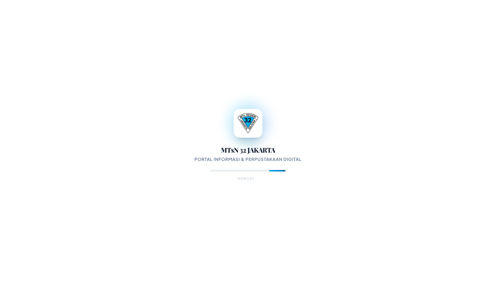
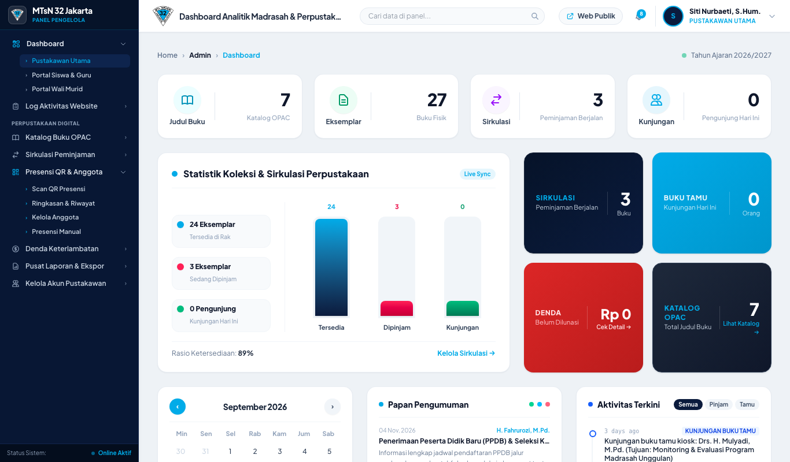
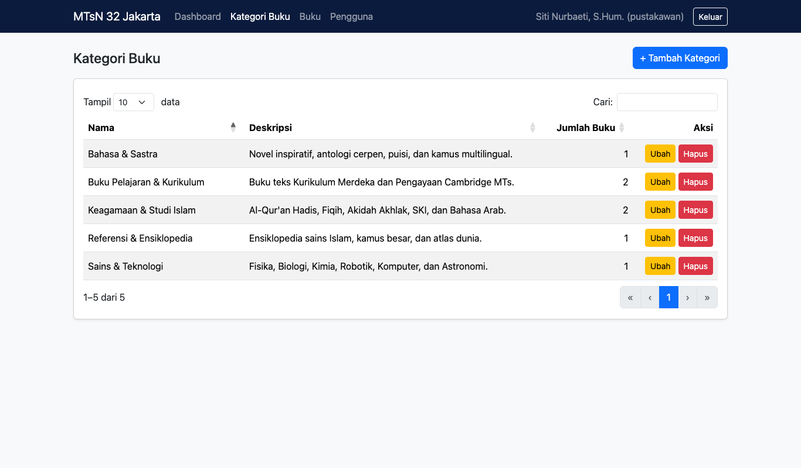
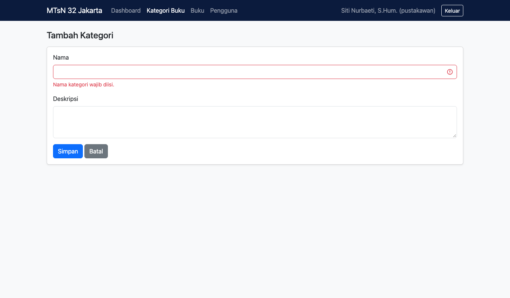
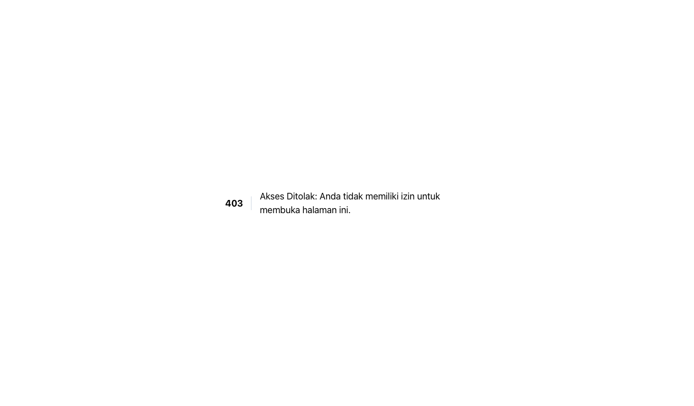

# Laporan Proyek UTS: Pemrograman Web Tingkat Mahir

**Tema:** Sistem Informasi Perpustakaan (bagian dari website MTsN 32 Jakarta)
**Teknologi:** Laravel (PHP 8.4), Blade, Eloquent ORM, migration & seeder, Bootstrap 5 + DataTables (modul Kategori), Tailwind (modul lainnya)
**Database:** SQLite saat ini; MySQL/MariaDB didukung dengan mengubah `.env` (lihat bagian 9)

---

## 1. Analisis Kebutuhan

**Masalah.** Pengelolaan buku, peminjaman, denda, dan kunjungan perpustakaan madrasah masih manual, dan informasi sekolah tersebar.

**Tujuan.** Satu aplikasi web yang menampilkan profil dan informasi madrasah, serta mengelola perpustakaan: katalog buku, anggota, peminjaman dan pengembalian, denda, dan kunjungan.

**Pengguna dan role.**

| Role | Siapa | Hak akses utama |
|---|---|---|
| `admin_madrasah` | Admin website | Kelola konten (berita, guru, fasilitas, galeri, ekskul, slider, PPDB), kelola akun admin, lihat portal siswa dan wali |
| `pustakawan` | Petugas perpustakaan | Kelola kategori, buku, eksemplar, sirkulasi, denda, kunjungan, laporan, akun pustakawan |
| `siswa_guru` | Anggota perpustakaan | Dashboard anggota, kartu QR, ubah password |
| `wali_murid` | Wali siswa | Memantau anak (peminjaman dan kunjungan), ubah password |

**Fitur utama.** Dashboard ringkasan, CRUD data, pencarian dan filter, login/logout, manajemen akun, pembatasan akses per role, laporan Excel/PDF, pemindaian QR kunjungan.

---

## 2. Perancangan Database (ERD)

Tabel utama untuk tema perpustakaan:

| Tabel | Fungsi | Kolom penting |
|---|---|---|
| `users` | Akun login | name, username, email, password (hash), role, is_active |
| `categories` | Kategori buku | name (unik), slug (unik), description |
| `books` | Judul buku | category_id, title, author, publisher, publication_year, isbn |
| `book_copies` | Eksemplar fisik | book_id, status (tersedia/dipinjam) |
| `members` | Anggota perpustakaan | user_id, member_type, nisn/nip, barcode |
| `loans` | Peminjaman | book_copy_id, member_id, status |
| `fines` | Denda | loan_id |
| `visits` | Kunjungan | member_id, recorded_by |
| `guardian_students` | Penghubung wali dan siswa | guardian_user_id, student_member_id |

Tabel konten madrasah: `articles`, `teachers_and_staff`, `facilities`, `extracurriculars`, `galleries`, `hero_slides`, `featured_programs`, `school_profiles`, `activity_logs`. Tabel pendukung: `qr_tokens`, `personal_access_tokens`, `sessions`, `cache`, `jobs`.

## Relasi

| Relasi | Jenis | Keterangan |
|---|---|---|
| `Category` → `Book` | one-to-many | Satu kategori punya banyak buku |
| `Book` → `BookCopy` | one-to-many | Satu judul punya banyak eksemplar |
| `BookCopy` → `Loan` | one-to-many | Satu eksemplar dipinjam berkali-kali |
| `Member` → `Loan` | one-to-many | Satu anggota punya banyak peminjaman |
| `Loan` → `Fine` | one-to-one | Satu peminjaman bisa punya satu denda |
| `User` → `Member` | one-to-one | Satu akun, satu data anggota |
| `Member` → `Visit` | one-to-many | Satu anggota banyak kunjungan |
| `User` (wali) ↔ `Member` (siswa) | many-to-many | Lewat tabel pivot `guardian_students` |

```text
categories 1──* books 1──* book_copies 1──* loans *──1 members 1──1 users
                                             │                │
                                             1                *
                                            fines          visits
users(wali) *──* members   (pivot: guardian_students)
```

---

## 3. Pemenuhan 11 Komponen Wajib

| No | Komponen | Status | Bukti |
|---|---|---|---|
| 1 | Dashboard | Terpenuhi | `Admin\DashboardController`, `resources/views/admin/dashboard.blade.php`, dashboard perpustakaan, dashboard anggota dan wali |
| 2 | Minimal 3 modul CRUD | Terpenuhi | Buku, Kategori, Guru/Staf, Berita, Fasilitas, Ekskul, Galeri, Slider, dan lainnya |
| 3 | Minimal 4 tabel berelasi, dibuat lewat migration | Terpenuhi | Sekitar 20 tabel di `database/migrations/` |
| 4 | Relasi one-to-many / many-to-many | Terpenuhi | Lihat tabel relasi di bagian 2 |
| 5 | Validasi input tambah/ubah beserta pesan error | Terpenuhi | `$request->validate()` dengan pesan bahasa Indonesia (contoh: `CategoryController`) |
| 6 | Search, filter, sorting, pagination (boleh DataTables) | Terpenuhi pada modul Kategori; sebagian pada modul lain | Kategori memakai DataTables lengkap. Buku, Guru, Berita punya search, filter, pagination; sorting kolom belum |
| 7 | Login dan logout | Terpenuhi | `AuthController`, route `/login` dan `/logout`, reset password |
| 8 | Manajemen pengguna dan role | Terpenuhi | `AdminManagementController`, `LibrarianManagementController`, impor dan CRUD anggota |
| 9 | Authorization minimal 2 role | Terpenuhi | 4 role, hak akses berbeda per role |
| 10 | Protected route | Terpenuhi | Middleware `auth` dan `RoleMiddleware` (`role:pustakawan`, dan seterusnya) di `routes/web.php` |
| 11 | Antarmuka Blade + Bootstrap 5 dengan navigasi konsisten | Sebagian | Blade dipakai di semua halaman. Bootstrap 5 baru dipakai di modul Kategori; halaman lain memakai Tailwind |

---

## 4. Ketentuan Teknis

| Ketentuan | Status |
|---|---|
| Laravel + MySQL/MariaDB | Laravel ya; database default SQLite, MySQL/MariaDB tinggal diatur di `.env` |
| Arsitektur MVC | Ya (`app/Models`, `app/Http/Controllers`, `resources/views`) |
| Eloquent ORM | Ya |
| Migration dan seeder | Ya (`database/migrations`, `database/seeders/DatabaseSeeder.php`) |
| Blade + Bootstrap 5 | Blade ya; Bootstrap 5 pada modul Kategori |
| Validasi Laravel | Ya |
| Password ter-hash | Ya (`Hash::make`, cast `hashed`) |

---

## 5. Modul Baru: Kategori Buku (Bootstrap 5 + DataTables)

Modul ini ditambahkan untuk menutup kekurangan pada komponen 6 dan 11.

**File.**
- `app/Http/Controllers/Admin/CategoryController.php`
- `resources/views/layouts/bootstrap.blade.php` (layout Bootstrap 5 dengan navbar)
- `resources/views/admin/categories/index.blade.php` dan `form.blade.php`
- `routes/web.php` (resource route `admin/kategori`)
- `tests/Feature/CategoryCrudTest.php`

**Perilaku.**
- Tambah, ubah, dan hapus kategori.
- Nama wajib diisi, unik, maksimal 100 karakter; deskripsi maksimal 500 karakter. Pesan error dalam bahasa Indonesia.
- Slug dibuat otomatis dan dijaga unik.
- Kategori yang masih dipakai buku tidak bisa dihapus.
- Tabel DataTables: pencarian, urut kolom, pagination, tampilan jumlah buku per kategori.
- Akses hanya untuk role `pustakawan`.

**Alamat.** `/admin/kategori`

---

## 6. Hak Akses per Role (Authorization)

| Area | admin_madrasah | pustakawan | siswa_guru | wali_murid |
|---|:---:|:---:|:---:|:---:|
| `/admin` dashboard | ya | ya | tidak | tidak |
| CMS (berita, guru, fasilitas, galeri, dan lainnya) | ya | tidak | tidak | tidak |
| Kategori, buku, sirkulasi, denda, kunjungan, laporan | tidak | ya | tidak | tidak |
| `/member` dashboard anggota | ya (pratinjau) | ya (pratinjau) | ya | tidak |
| `/wali` dashboard wali | ya (pratinjau) | ya (pratinjau) | tidak | ya |

Akses ditolak mengembalikan halaman 403, dan pengguna yang belum login diarahkan ke `/login`.

---

## 7. Akun Uji (dari seeder)

| Role | Username | Password |
|---|---|---|
| admin_madrasah | `admin` | `admin123` |
| pustakawan | `pustakawan` | `password` |
| siswa_guru | `siswa`, `siswa2`, `guru` | `password` |
| wali_murid | `wali_0081234567` | `password` |

Akun ini hanya untuk pengembangan. Ganti semua password sebelum dipakai di server publik.

---

## 8. Pengujian

- Jalankan seluruh tes: `php artisan test --compact` (194 tes lulus, termasuk 5 tes untuk modul Kategori).
- Tes Kategori mencakup: tamu dan role lain ditolak, tambah/ubah/hapus, validasi dan nama ganda, kategori yang dipakai tidak bisa dihapus, dan halaman daftar tampil.
- Uji manual untuk demo: login dengan tiap akun di bagian 7, lalu coba buka `/admin/kategori` dengan akun `admin` (harus 403) dan dengan akun `pustakawan` (harus tampil).

---

## 9. Cara Menjalankan

```bash
composer install
cp .env.example .env && php artisan key:generate
# Untuk MySQL/MariaDB, ubah di .env:
#   DB_CONNECTION=mysql
#   DB_HOST=127.0.0.1
#   DB_PORT=3306
#   DB_DATABASE=nama_database
#   DB_USERNAME=root
#   DB_PASSWORD=
php artisan migrate --seed
npm install && npm run build
php artisan serve
```

Dengan Laravel Herd, situs sudah tersedia di `http://website-mtsn32.test`.

---

## 10. Catatan dan Keterbatasan

1. Bootstrap 5 baru dipakai di modul Kategori. Halaman admin lain (Buku, Guru, Berita, dan seterusnya) masih memakai Tailwind. Migrasi penuh ke Bootstrap sekitar 6.500 baris view.
2. Sorting kolom dan DataTables belum ada di tabel Buku, Guru, dan Berita (yang ada: search, filter, pagination).
3. Halaman Kategori memakai navbar Bootstrap sendiri dan belum tampil di sidebar Tailwind.
4. Bootstrap dan DataTables dimuat dari CDN, sehingga halaman Kategori perlu koneksi internet.
5. Database default masih SQLite; belum diuji pada MySQL/MariaDB.
6. Tampilan halaman Kategori sudah diperiksa di browser (lihat tangkapan layar di bagian 11) dan lewat tes otomatis.

---

## 11. Tangkapan Layar

**Halaman login**



**Dashboard perpustakaan (akun `pustakawan`)**



**Daftar Kategori Buku dengan DataTables (cari, urut, pagination, jumlah buku)**



**Validasi form Tambah Kategori (pesan error bahasa Indonesia)**



**Protected route: akun `admin` membuka `/admin/kategori` ditolak 403**


