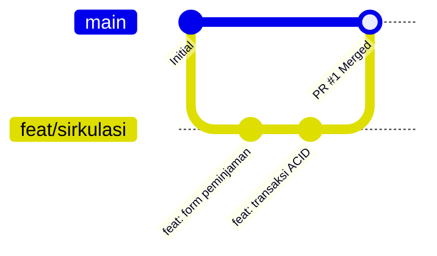

# Sistem Informasi Terpadu & Perpustakaan Digital MTsN 32 Jakarta

Selamat datang di repositori resmi **Sistem Informasi Terpadu & Perpustakaan Digital MTsN 32 Jakarta**. 

Aplikasi web ini menggabungkan portal informasi madrasah dengan layanan otomasi perpustakaan (katalog OPAC, presensi pengunjung kiosk mode, sirkulasi peminjaman & pengembalian buku fisik, serta pembaca buku digital terproteksi dengan Dynamic Watermark).

---

## 🚀 Panduan Instalasi & Menjalankan Proyek

### Prasyarat Sistem
Pastikan perangkat Anda sudah terpasang:
- **PHP** >= 8.3 (dengan ekstensi: `pdo`, `mbstring`, `openssl`, `tokenizer`, `xml`, `ctype`, `json`, `bcmath`)
- **Composer** (versi terbaru)
- **Node.js** (v18+ atau v20+) & **NPM**
- **Database Server:** MySQL / MariaDB / PostgreSQL (atau SQLite untuk pengembangan lokal)
- *(Opsional)* **Laravel Herd** untuk kemudahan environment lokal di Windows/macOS.

### Langkah Instalasi

1. **Clone Repositori**
   ```bash
   git clone https://github.com/rendikaadji/website-MTsN32.git
   cd website-MTsN32
   ```

2. **Install Dependensi Backend (PHP)**
   ```bash
   composer install
   ```

3. **Konfigurasi Environment File**
   Salin file konfigurasi lingkungan:
   ```bash
   cp .env.example .env
   ```
   *Bagi pengguna Windows PowerShell:*
   ```powershell
   copy .env.example .env
   ```

4. **Generate Application Key**
   ```bash
   php artisan key:generate
   ```

5. **Konfigurasi Database & Jalankan Migrasi**
   Buka file `.env` dan sesuaikan kredensial database Anda:
   ```env
   DB_CONNECTION=mysql
   DB_HOST=127.0.0.1
   DB_PORT=3306
   DB_DATABASE=mtsn32_db
   DB_USERNAME=root
   DB_PASSWORD=
   ```
   Setelah itu, jalankan migrasi tabel:
   ```bash
   php artisan migrate
   ```
   *(Opsional) Jika ingin menyertakan data awal/seeder:*
   ```bash
   php artisan migrate --seed
   ```
   > Untuk pengembangan lokal paling praktis memakai SQLite: set `DB_CONNECTION=sqlite`, hapus baris `DB_HOST` s.d. `DB_PASSWORD`, lalu buat file kosong `database/database.sqlite`.

6. **Hubungkan Folder Upload ke Public**
   Wajib dijalankan sekali agar gambar yang diunggah lewat admin (sampul buku, galeri, foto guru) bisa tampil:
   ```bash
   php artisan storage:link
   ```

7. **Install Dependensi Frontend & Compile Asset**
   ```bash
   npm install
   npm run dev     # mode pengembangan (auto-reload saat file diubah)
   npm run build   # atau: build sekali, tanpa perlu terminal terbuka
   ```
   > Folder `public/build` tidak ikut di Git. Setiap selesai `git pull` atau pindah branch yang mengubah CSS/JS, jalankan ulang `npm run build` (atau biarkan `npm run dev` tetap berjalan).

8. **Menjalankan Server Aplikasi**
   - **Jika menggunakan Laravel Herd:** Akses langsung di browser Anda melalui alamat domain lokal (misalnya: `http://mtsn32-web.test` atau `http://website-mtsn32.test`).
   - **Jika menggunakan PHP CLI biasa:**
     ```bash
     php artisan serve
     ```
     Buka browser di `http://127.0.0.1:8000`.

---

## 🌿 Panduan Git & Branching Workflow (Wajib untuk Tim)

> [!IMPORTANT]
> **DILARANG KERAS melakukan `git push` langsung ke branch `main`!**
> Seluruh pengerjaan fitur, perbaikan bug, maupun pembaruan dokumentasi wajib dikerjakan di branch terpisah dan digabungkan ke `main` hanya melalui mekanisme **Pull Request (PR)**.

### Alur Kerja Standar:



#### 1. Sinkronisasi Branch `main` Terbaru
Sebelum mulai membuat fitur atau perubahan baru, pastikan branch `main` di lokal Anda dalam kondisi paling mutakhir:
```bash
git checkout main
git pull origin main
```

#### 2. Buat Branch Baru Sesuai Tujuan
Gunakan konvensi penamaan branch standar:
- `feat/nama-fitur` $\rightarrow$ Penambahan fitur baru (contoh: `feat/sirkulasi-peminjaman`, `feat/gate-presensi`, `feat/opac-search`).
- `fix/nama-bug` $\rightarrow$ Perbaikan bug/masalah (contoh: `fix/hitung-denda`, `fix/redirect-login`).
- `docs/nama-perubahan` $\rightarrow$ Perubahan/pembaruan dokumentasi (contoh: `docs/update-schema`, `docs/panduan-setup`).
- `refactor/nama-modul` $\rightarrow$ Restrukturisasi kode tanpa mengubah fungsionalitas.

Contoh pembuatan branch:
```bash
git checkout -b feat/sirkulasi-peminjaman
```

#### 3. Kerjakan Kode & Lakukan Commit
Simpan perubahan secara berkala dengan pesan commit yang jelas. **Selalu cek `git status` sebelum commit** untuk memastikan hanya file project yang ikut:
```bash
git add .
git status          # periksa daftar file yang akan di-commit
git commit -m "feat: implementasi alur peminjaman buku dengan transaksi ACID"
```
Jika ada file yang tidak seharusnya ikut, keluarkan dengan `git restore --staged <file>`.

Format pesan commit: `feat:` fitur baru, `fix:` perbaikan bug, `style:` tampilan/tema, `docs:` dokumentasi, `chore:` konfigurasi/pemeliharaan.

#### 4. Push Branch ke Remote (GitHub)
Kirim branch kerja Anda ke GitHub:
```bash
git push -u origin feat/sirkulasi-peminjaman
```

#### 5. Buat Pull Request (PR) di GitHub
1. Masuk ke halaman repositori: [website-MTsN32 di GitHub](https://github.com/rendikaadji/website-MTsN32).
2. Klik tombol **Compare & pull request** pada branch yang baru saja di-push.
3. Pastikan arah merge adalah `base: main` $\leftarrow$ `compare: feat/sirkulasi-peminjaman`.
4. Isi judul dan deskripsi PR secara informatif:
   - Apa yang ditambahkan/diubah.
   - Referensi modul terkait di `mtsn32-docs/`.
   - Bukti uji coba/testing.
5. Minta review dari rekan tim.
6. Setelah di-review dan disetujui (Approved), lakukan **Merge Pull Request**.

#### 6. Bersihkan Branch Lokal Setelah Merge
Setelah PR selesai di-merge di GitHub:
```bash
git checkout main
git pull origin main
git branch -d feat/sirkulasi-peminjaman
```

### Bekerja Berdua di Branch yang Sama

Selalu **`git pull` sebelum mulai kerja dan sebelum `git push`**.

```bash
git pull origin nama-branch
# ... kerjakan, lalu commit ...
git pull origin nama-branch   # ambil perubahan rekan yang masuk selama Anda bekerja
git push origin nama-branch
```

- **Push ditolak (`! [rejected] ... (fetch first)`)?** Artinya rekan sudah push lebih dulu. Tidak ada yang hilang: jalankan `git pull`, selesaikan konflik jika ada, lalu `git push` lagi.
- **Merge conflict** terjadi jika dua orang mengubah baris yang sama. Buka file yang ditandai `<<<<<<<` / `=======` / `>>>>>>>`, pilih atau gabungkan isinya, hapus tanda tersebut, lalu `git add <file>` dan `git commit`. Batalkan dengan `git merge --abort` jika ragu.
- **Pekerjaan belum siap di-commit** tetapi harus pull? Simpan sementara dengan `git stash -u`, lalu `git pull`, lalu `git stash pop`.
- **DILARANG `git push --force`** di branch bersama: perintah ini menimpa dan menghapus commit rekan di GitHub.
- Kabari rekan sebelum mengubah file yang sering dipakai bersama: file migration, `routes/web.php`, dan layout (`resources/views/layouts/*`).

### Me-review Branch Rekan

```bash
git fetch origin
git checkout nama-branch-rekan      # contoh: feat/portal-publik-dan-admin
git pull
git diff main...HEAD --stat         # lihat file apa saja yang berubah
```

Setiap branch bisa punya tabel database dan asset frontend yang berbeda, dan keduanya **tidak ikut berganti** saat `git checkout`. Setelah pindah branch (termasuk saat kembali ke branch sendiri), jalankan:

```bash
composer install              # jika composer.json berubah
npm install                   # jika package.json berubah
php artisan migrate:fresh --seed
npm run build
```

> [!WARNING]
> `migrate:fresh` **menghapus seluruh data lokal**. Hentikan dulu server/`composer run dev` dan tutup aplikasi yang membuka file database (DB Browser, dll.) agar tidak muncul error `disk I/O error`.

Untuk kembali ke branch sebelumnya: `git checkout -` atau `git checkout nama-branch-anda`.

### File yang Tidak Boleh Masuk Repository

Sudah diatur di `.gitignore`, jangan di-commit paksa (`git add -f`):

- `.env` dan file berisi password/API key.
- `vendor/`, `node_modules/`, `public/build/`, `public/storage`.
- File konfigurasi AI tools pribadi: `.claude/`, `.agents/`, `.cursor/`, `.codex/`, `.factory/`, `.grok/`, `.gemini/`, `.windsurf/`, `.junie/`, `.playwright-mcp/`, `.mcp.json`, `boost.json`, `CLAUDE.md`, `AGENTS.md`, `GEMINI.md`.

Jika memakai tool baru yang membuat folder konfigurasi di root project, tambahkan folder tersebut ke `.gitignore` dalam commit terpisah (`chore: ...`).

---

## 🧯 Masalah Umum Saat Setup

| Error / Gejala | Penyebab | Solusi |
|---|---|---|
| `Unable to locate file in Vite manifest` | Asset frontend belum di-build untuk branch ini | `npm run build` (atau jalankan `npm run dev`) |
| `no such table: ...` | Migration branch ini belum dijalankan | `php artisan migrate` |
| `table "..." already exists` saat migrate | Database masih berisi tabel dari branch lain | `php artisan migrate:fresh --seed` (menghapus data lokal) |
| `disk I/O error` (SQLite) | File database sedang dipakai proses lain | Hentikan server dev / tutup DB Browser, lalu ulangi perintah |
| Gambar upload tidak tampil / 404 / 403 | `public/storage` belum dibuat | `php artisan storage:link` |
| Perubahan tampilan tidak muncul | Asset lama masih dipakai | `npm run build`, lalu `php artisan view:clear` dan hard refresh browser (Ctrl+F5) |
| `git push` → `does not appear to be a git repository` | Nama remote tidak ditulis | `git push origin nama-branch` |

---

## 📖 Panduan Dokumentasi Sistem (`mtsn32-docs`)

Direktori [`mtsn32-docs/`](./mtsn32-docs/) merupakan **Single Source of Truth (SSOT)** untuk seluruh arsitektur dan aturan sistem. Seluruh developer dan **AI Coding Assistant** (Cursor, Windsurf, Claude Code, GitHub Copilot, Antigravity, dll.) **wajib** membaca dan mematuhi dokumentasi ini sebelum menulis kode.

### 1. Struktur & Peran Dokumen

| File | Nama Dokumen | Peran & Deskripsi |
|---|---|---|
| [**`prd.md`**](./mtsn32-docs/prd.md) | **Product Requirements Document** | **Sumber kebenaran tertinggi.** Berisi kebutuhan produk, daftar modul, matriks peran & hak akses pengguna (RBAC), user flows, dan kriteria penerimaan. |
| [**`rules.md`**](./mtsn32-docs/rules.md) | **Aturan untuk AI Coding Assistant** | Aturan ketat untuk AI dan developer: hierarki kebenaran, disiplin scope, standar keamanan, transaksi database ACID, dan konvensi penamaan. |
| [**`architecture.md`**](./mtsn32-docs/architecture.md) | **Arsitektur Sistem** | Gambaran umum sistem, peta route & otorisasi, alur teknis per modul (presensi, sirkulasi, buku digital), serta integrasi perangkat kiosk/scanner. |
| [**`schema.md`**](./mtsn32-docs/schema.md) | **Struktur Database** | Rancangan skema tabel, tipe data, foreign key, index, dan aturan integritas data relasional. |
| [**`design.md`**](./mtsn32-docs/design.md) | **Panduan UI/UX** | Prinsip desain antarmuka, responsivitas mobile-first, struktur landing page per peran, tata letak kiosk mode (`/gate`), dan konsistensi komponen UI. |

### 2. Hierarki Sumber Kebenaran

Jika terdapat ketidaksesuaian antardokumen:
1. **`prd.md`** menang atas semua dokumen lainnya.
2. **`schema.md`** menjadi acuan utama struktur data dan integritas database.
3. **`architecture.md`** dan **`design.md`** menjelaskan cara mengimplementasikan fitur tersebut.
4. **Item bertanda `[BELUM DITETAPKAN]` atau `TBD`:** Dilarang membuat asumsi sepihak. Selalu diskusikan dengan tim/Product Owner terlebih dahulu.

---

## 🤖 Cara Mengarahkan AI Coding Assistant

Agar AI menghasilkan kode yang akurat, aman, dan sesuai spesifikasi, pastikan AI membaca dokumen di `mtsn32-docs/` **terlebih dahulu** pada setiap sesi pengerjaan.

### Metode Mention Context (`@`)
Sertakan file dokumentasi terkait di kolom chat AI (Cursor, Windsurf, Antigravity, dll.):
```text
@mtsn32-docs/rules.md @mtsn32-docs/prd.md @mtsn32-docs/architecture.md @mtsn32-docs/schema.md
Tolong buatkan migration, model, dan controller untuk modul Sirkulasi (Peminjaman dan Pengembalian Buku). Pastikan transaksi bersifat ACID sesuai schema.md dan periksa otorisasi sesuai prd.md.
```

### Template Prompt Standar (Siap Salin)
Gunakan template prompt berikut saat memulai sesi baru bersama AI:

```markdown
Sebelum menulis atau mengubah kode apa pun, baca dan pahami seluruh panduan di:
1. `mtsn32-docs/rules.md` (Aturan wajib & disiplin scope)
2. `mtsn32-docs/prd.md` (Spesifikasi fitur & matriks hak akses)
3. `mtsn32-docs/architecture.md` (Arsitektur & peta route)
4. `mtsn32-docs/schema.md` (Skema database & integritas data)
5. `mtsn32-docs/design.md` (Panduan UI/UX & istilah)

Tugas saya saat ini adalah:
[Jelaskan fitur/modul yang ingin dibuat atau diperbaiki]

Ketentuan pengerjaan:
- Patuhi hierarki sumber kebenaran (PRD adalah acuan tertinggi).
- Jangan menambah fitur, tabel, kolom, atau route di luar yang ada di dokumentasi.
- Identifier kode (variabel, fungsi, route, kolom) dalam Bahasa Inggris; teks UI & pesan sistem dalam Bahasa Indonesia.
- Jika ada hal bertanda [BELUM DITETAPKAN], tanyakan kepada saya sebelum berasumsi.
- Jelaskan secara ringkas langkah yang akan kamu lakukan sebelum menulis kode.
```

---

## 🛡️ Aturan Utama Proyek (Engineering Guidelines)

1. **Otorisasi di Sisi Server (Server-Side Enforcement):**
   - Pemeriksaan hak akses wajib dilakukan di controller/policy/middleware, bukan sekadar menyembunyikan tombol di antarmuka.
   - Siswa & Guru hanya dapat melihat data pribadi mereka.
   - Wali Murid hanya dapat melihat data anak yang terhubung lewat tabel `guardian_students`.
2. **Transaksi ACID Wajib:**
   - Proses peminjaman dan pengembalian buku wajib berada dalam satu transaksi database (`DB::transaction`). Jika ada satu langkah gagal, lakukan rollback penuh.
3. **Waktu Server:**
   - Waktu presensi (`visits`) dan transaksi peminjaman/pengembalian wajib menggunakan waktu server (`now()`), bukan waktu dari klien.
4. **Konvensi Bahasa & Penamaan:**
   - **Kode:** Variabel, fungsi, method, route, tabel, dan kolom wajib menggunakan **Bahasa Inggris**.
   - **Antarmuka (UI):** Seluruh label, form, notifikasi, dan pesan error menggunakan **Bahasa Indonesia** yang baku dan ramah.
5. **Keamanan Buku Digital:**
   - File buku digital disimpan di folder **private** (bukan public storage).
   - Ditampilkan hanya melalui endpoint terproteksi dengan **Dynamic Watermark** (identitas pengguna yang membaca).
6. **Konsistensi Tema & Logo:**
   - Seluruh halaman (portal publik, admin, dan aplikasi React presensi) memakai palet yang sama: biru utama `#01ABE8` (hover `#0284C7`), navy `#0B1B3D` untuk header/area gelap, latar `#F8FAFC`, teks & border dari skala `slate` Tailwind.
   - Font: **Plus Jakarta Sans** (teks) dan **Playfair Display** (judul).
   - Logo resmi: `public/images/logo-mtsn32.png`. Jangan membuat logo pengganti/placeholder; di atas latar gelap letakkan logo dalam wadah putih.

---

> [!NOTE]
> Jika ada pertanyaan teknis atau perbedaan pendapat mengenai kebutuhan fitur, selalu diskusikan di forum tim pengembang terlebih dahulu sebelum mengubah kode.
