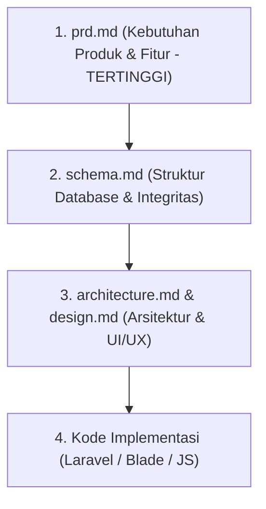

# Panduan Dokumentasi Sistem MTsN 32 Jakarta (`mtsn32-docs`)

Selamat datang di direktori dokumentasi resmi **Sistem Informasi Terpadu & Perpustakaan Digital MTsN 32 Jakarta**.

Direktori ini merupakan **Single Source of Truth (SSOT)** untuk seluruh pengembangan aplikasi. Seluruh anggota tim pengembang dan **AI Coding Assistant** (seperti Cursor, Windsurf, Claude Code, GitHub Copilot, Antigravity, dll.) **wajib** memahami dan mematuhi panduan di sini sebelum merancang atau menulis kode.

---

## 1. Struktur & Peran Dokumen

Dokumentasi ini dibagi menjadi 5 file spesifik agar mudah dipahami oleh manusia maupun AI:

| File | Nama Dokumen | Peran & Deskripsi |
|---|---|---|
| [**`prd.md`**](./prd.md) | **Product Requirements Document** | **Sumber kebenaran tertinggi.** Berisi latar belakang, tujuan sistem, daftar modul, matriks hak akses pengguna (RBAC), user flows, dan kriteria penerimaan. |
| [**`rules.md`**](./rules.md) | **Aturan untuk AI Coding Assistant** | Berisi aturan ketat bagi AI dan developer: hierarki kebenaran, disiplin scope, standar keamanan, transaksi database ACID, konvensi kode/bahasa, dan batas kewenangan. |
| [**`architecture.md`**](./architecture.md) | **Arsitektur Sistem** | Berisi gambaran umum sistem teknis, peta route & otorisasi, alur teknis per modul (presensi, sirkulasi, buku digital), dan integrasi perangkat kiosk/scanner. |
| [**`schema.md`**](./schema.md) | **Struktur Database** | Berisi rancangan skema tabel, tipe data, foreign key, index, serta aturan integritas data relasional. |
| [**`design.md`**](./design.md) | **Panduan UI/UX** | Berisi prinsip desain antarmuka, responsivitas mobile-first, struktur landing page per peran, tata letak kiosk mode (`/gate`), dan konsistensi komponen UI. |

---

## 2. Hierarki Sumber Kebenaran

Jika terdapat ketidaksesuaian atau ambiguitas antardokumen, gunakan hierarki berikut:



1. **`prd.md`** menang atas semua dokumen teknis lainnya.
2. **`schema.md`** menjadi acuan utama struktur data dan integritas database.
3. **`architecture.md`** dan **`design.md`** menjelaskan cara mengimplementasikan fitur tersebut.
4. **Item bertanda `[BELUM DITETAPKAN]` atau `TBD`**: Dilarang membuat asumsi sepihak. Selalu diskusikan dengan tim/Product Owner terlebih dahulu.

---

## 3. Panduan untuk Tim: Cara Mengarahkan AI Coding Assistant

Agar AI menghasilkan kode yang akurat, aman, dan sesuai spesifikasi, pastikan AI membaca dokumen di `mtsn32-docs/` **terlebih dahulu** pada setiap sesi tugas atau prompt baru.

### 3.1. Metode Menggunakan Mention Context (`@`)

Jika menggunakan editor AI seperti **Cursor**, **Windsurf**, atau **Antigravity**, selalu sertakan file dokumentasi terkait di chat:

```text
@mtsn32-docs/rules.md @mtsn32-docs/prd.md @mtsn32-docs/architecture.md @mtsn32-docs/schema.md
Tolong buatkan migration, model, dan controller untuk modul Sirkulasi (Peminjaman dan Pengembalian Buku). Pastikan transaksi bersifat ACID sesuai schema.md dan periksa otorisasi sesuai prd.md.
```

### 3.2. Template Prompt Standar (Copy-Paste Ready)

Gunakan template prompt berikut saat memberikan tugas baru kepada AI:

```markdown
Sebelum menulis atau mengubah kode apa pun, baca dan pahami seluruh panduan di:
1. `mtsn32-docs/rules.md` (Aturan wajib & disiplin scope)
2. `mtsn32-docs/prd.md` (Spesifikasi fitur & matriks hak akses)
3. `mtsn32-docs/architecture.md` (Arsitektur & peta route)
4. `mtsn32-docs/schema.md` (Skema database & integritas data)
5. `mtsn32-docs/design.md` (Panduan UI/UX & istilah)

Tugas saya saat ini adalah:
[Jelaskan fitur/modul yang ingin dibuat atau diperbaiki]

Ketentuan pengerjaan:
- Patuhi hierarki sumber kebenaran (PRD adalah acuan tertinggi).
- Jangan menambah fitur, tabel, kolom, atau route di luar yang ada di dokumentasi.
- Identifier kode (variabel, fungsi, route, kolom) dalam Bahasa Inggris; teks UI & pesan sistem dalam Bahasa Indonesia.
- Jika ada hal bertanda [BELUM DITETAPKAN], tanyakan kepada saya sebelum berasumsi.
- Jelaskan secara ringkas langkah yang akan kamu lakukan sebelum menulis kode.
```

### 3.3. Mengonfigurasi Aturan AI Otomatis (Workspace Rules)

Agar Anda tidak perlu mengetik ulang instruksi di setiap percakapan, Anda dapat mendaftarkan referensi `mtsn32-docs/` ke dalam konfigurasi AI:

- **Cursor (`.cursorrules` atau `.cursor/rules/*.mdc`)**:
  Tambahkan instruksi:
  ```text
  Always consult and prioritize `mtsn32-docs/rules.md`, `mtsn32-docs/prd.md`, `mtsn32-docs/architecture.md`, and `mtsn32-docs/schema.md` before generating any code or proposing architecture changes.
  ```
- **Claude Code (`CLAUDE.md`) & Agent Guidelines (`AGENTS.md`)**:
  Pastikan instruksi membaca `mtsn32-docs/` tercantum sebagai acuan wajib bagi setiap agen AI yang bekerja di repositori ini.

---

## 4. Prinsip Utama yang Wajib Diingat Tim & AI

### 🛡️ Keamanan & Otorisasi
- **Otorisasi di Sisi Server (Server-Side Enforcement):** Jangan pernah hanya menyembunyikan tombol/menu di UI. Setiap route, controller, dan action wajib memeriksa role dan kepemilikan data pengguna.
- **Kepemilikan Data:**
  - Siswa & Guru hanya dapat melihat data milik mereka sendiri.
  - Wali Murid hanya dapat melihat data anak yang terhubung via `guardian_students`.
  - Buku digital wajib disimpan di direktori **private** dan disajikan melalui endpoint terproteksi dengan **Dynamic Watermark**.

### ⚡ Integritas Data & Transaksi
- **Transaksi ACID Wajib:** Alur peminjaman (`loans`) dan pengembalian buku wajib berada dalam satu blok transaksi database (`DB::transaction`). Jika satu langkah gagal, lakukan rollback penuh.
- **Waktu Server:** Waktu presensi (`visits`) dan transaksi peminjaman/pengembalian wajib menggunakan waktu server (`now()`), bukan waktu dari klien.
- **Konfigurasi Dinamis:** Denda, durasi pinjam, dan kuota peminjaman dibaca dari tabel konfigurasi (`loan_rules`), **bukan di-hardcode**.

### 🌐 Konvensi Bahasa & Penamaan
- **Kode:** Nama variabel, fungsi, class, method, route, tabel database, dan kolom menggunakan **Bahasa Inggris** (contoh: `book_copies`, `LoanController`, `visited_at`).
- **Antarmuka (UI):** Semua teks tampilan pengguna, label tombol, form, notifikasi, dan pesan error menggunakan **Bahasa Indonesia** yang ramah dan mudah dipahami (contoh: "Katalog Buku", "Peminjaman & Pengembalian", "Presensi Pengunjung").

---

## 5. Cara Memperbarui Dokumentasi

Jika terjadi perubahan kebutuhan madrasah di masa mendatang:

1. **Diskusikan Perubahan:** Ajukan perubahan ke tim/Product Owner.
2. **Update Dokumentasi Terlebih Dahulu (Doc-First Development):**
   - Perubahan fitur/role $\rightarrow$ perbarui [`prd.md`](./prd.md).
   - Perubahan struktur tabel/kolom $\rightarrow$ perbarui [`schema.md`](./schema.md).
   - Perubahan route/alur modul $\rightarrow$ perbarui [`architecture.md`](./architecture.md).
   - Perubahan tampilan/komponen $\rightarrow$ perbarui [`design.md`](./design.md).
3. **Baru Lakukan Koding:** Terapkan perubahan pada kode aplikasi setelah dokumentasi diperbarui dan disepakati.

---

> [!NOTE]
> Jika ada pertanyaan atau ketidakjelasan pada isi dokumentasi, silakan buka diskusi di tim pengembang sebelum mengambil keputusan teknis.
